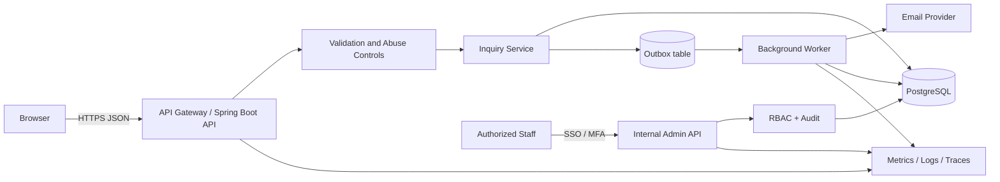

# Proposed Backend Architecture

This is a recommended design for a contact inquiry workflow, not a diagram of Cynbit's verified production architecture.

## Request flow
1. Browser sends JSON over HTTPS.
2. API enforces size limits, validation, rate limiting and idempotency.
3. Service stores inquiry and outbox event in one transaction.
4. API returns a generic acknowledgement with an opaque identifier.
5. Worker sends notification asynchronously.
6. Worker records delivery outcome and retries transient failures.
7. Staff use authenticated, role-protected endpoints.
8. Logs and metrics use correlation IDs and avoid personal message content.
